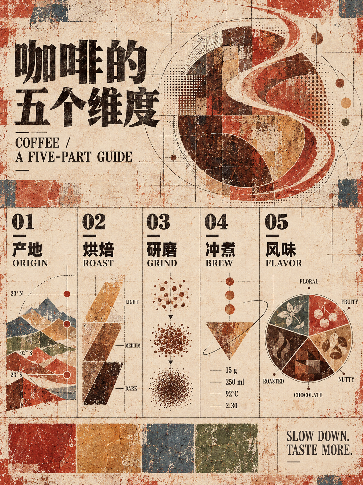
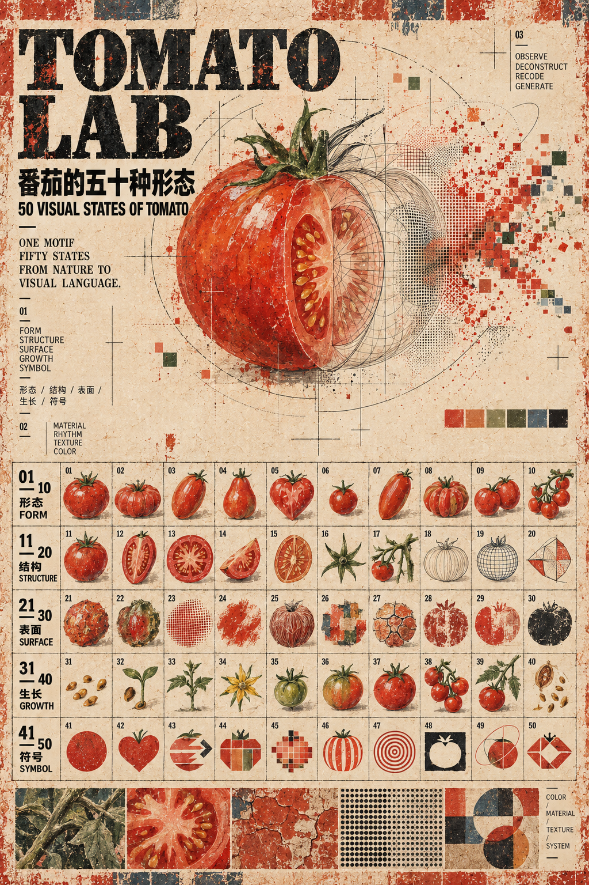
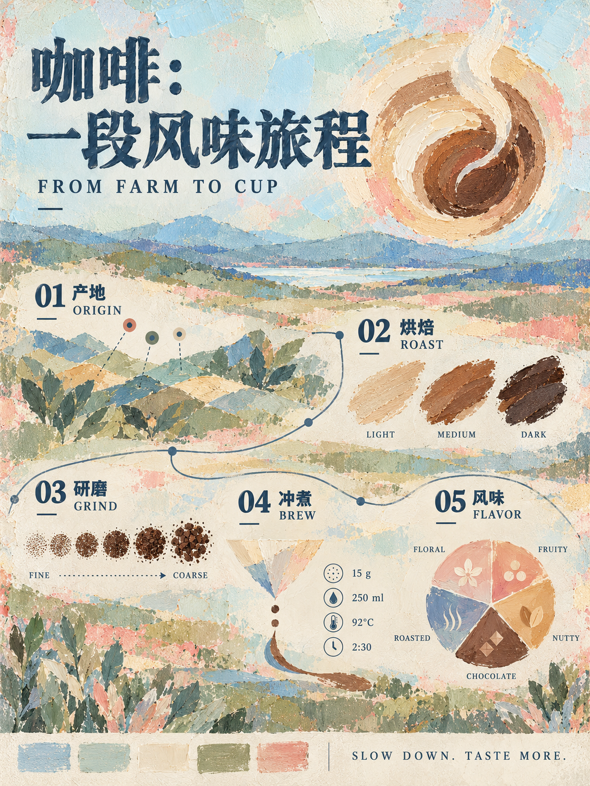
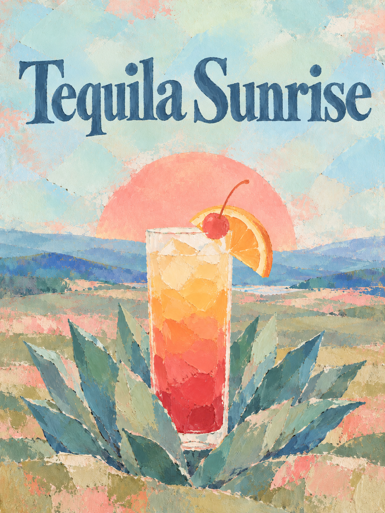

# Mural Poster Infographics

一套用于 Codex 的双分支视觉生成 Skill，面向艺术海报、编辑型信息图、视觉形态研究与系列化图像创作。

A two-branch Codex skill for art posters, editorial infographics, visual-form studies, and cohesive image series.

## Showcase / 作品展示

### Branch A — Weathered Mineral Mural / 风化矿物壁画

| 50 visual forms of an orange | Coffee: a five-part guide |
| --- | --- |
|  |  |

| Tomato Lab |
| --- |
|  |

Branch A 使用低饱和砖红、赭石、旧纸与矿物颜料语言，结合风化墙面、干刷、褪色套印和构成主义编辑布局。

Branch A uses restrained brick red, ochre, aged paper, mineral pigments, dry-brush wear, faded overprint, and constructivist editorial composition.

### Branch B — Pastel Impasto Pastoral / 粉彩厚涂牧歌

| Coffee flavor journey | Tequila Sunrise |
| --- | --- |
|  |  |

Branch B 使用单一参考图建立粉蓝、薄荷、灰绿与珊瑚色体系，强调刮刀厚涂、宽阔色块、轻盈留白和非写实主体。

Branch B derives its palette and material language from one reference image: powder blue, mint, sage, coral accents, palette-knife impasto, broad color fields, open space, and deliberately non-photoreal subjects.

## What it does / 能做什么

- 创作标题主导的艺术海报与数据密集型编辑信息图。
- 在两个明确分离的视觉分支之间自动路由，避免风格互相污染。
- 支持精确标题、双语标签、编号矩阵、流程图、类型学和视觉状态研究。
- 将参考图明确区分为风格参考、布局参考或编辑目标。
- Create title-led posters and structured editorial infographics.
- Route between two intentionally separate visual systems.
- Handle exact display copy, bilingual labels, numbered matrices, processes, typologies, and visual-state studies.
- Assign explicit roles to style references, layout references, and edit targets.

## Install / 安装

### macOS / Linux

```bash
git clone https://github.com/wyyyyyyyy-design/mural-poster-infographics.git ~/.codex/skills/mural-poster-infographics
```

### Windows PowerShell

```powershell
git clone https://github.com/wyyyyyyyy-design/mural-poster-infographics.git "$env:USERPROFILE\.codex\skills\mural-poster-infographics"
```

安装后新开一个 Codex 对话即可使用。After installation, start a new Codex chat.

## Usage / 使用

显式调用：

```text
使用 $mural-poster-infographics，把“龙舌兰基酒的酿造流程”制作成 Branch B 粉彩厚涂信息图，画风不要太写实。
```

```text
Use $mural-poster-infographics to create a Branch A editorial chart showing 30 visual states of a tomato.
```

你也可以直接描述目标；技能默认允许自动调用。

You can also describe the desired result directly; implicit invocation is enabled.

## Structure / 目录

```text
.
├── SKILL.md
├── agents/
│   └── openai.yaml
├── assets/
│   ├── branch-b-reference.jpg
│   ├── infographic-example.png
│   ├── poster-example.png
│   └── style-source.png
├── references/
│   ├── infographic-mode.md
│   ├── pastel-impasto-branch.md
│   ├── poster-mode.md
│   └── style-system.md
└── showcase/
```

## Notes / 注意

- The bundled images are visual references and examples, not mandatory subject matter.
- Generated typography and dense matrices should always be inspected after generation.
- Branch B uses `assets/branch-b-reference.jpg` as its only style/material reference.
- 展示图仅用于说明可实现的视觉方向；每次生成结果会有所不同。

## License / 许可

- Skill instructions and metadata: [MIT License](LICENSE)
- Reference and showcase images: [CC BY 4.0](ASSET_LICENSE.md)

